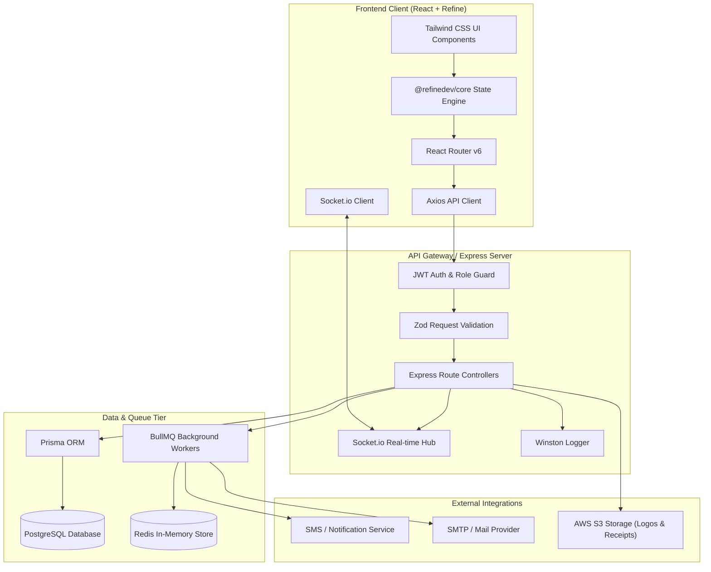

The Wild Game Butcher (WGB) platform is designed as an enterprise-grade, multi-tier web application tailored for real-time shop floor operations, regulatory data integrity, and high-volume seasonal intake.

## High-level architecture

## Frontend application architecture

The frontend (`wgb-frontend`) is built with modern React and TypeScript, leveraging the Refine framework for rapid data management:

* **Framework & Core Engine**: React 18 with TypeScript, powered by `@refinedev/core` for seamless CRUD mutations, caching, and layout management.
* **Routing & Authentication**: `react-router-dom` v6 with custom `<AuthenticatedRoute>` wrappers that enforce user token validity and role-based permissions.
* **Styling & Design System**: Tailwind CSS with custom badge and state styles (`StatusBadgeStyles`, `ColorVariants`).
* **Order Creation Wizard**: A structured step layout (`CartLayout`, `NewOrderLayout`) supporting complex multi-step state persistence across customer selection, harvest verification, cut profiles, and recipe add-ons.
* **Live Notifications**: `socket.io-client` with auto-reconnection and transport fallback (polling and WebSocket) to deliver instant updates when carcasses are processed or invoices become ready.

## Backend services architecture

The backend (`wgb-backend`) is built on Node.js and Express with a layered architecture:

* **HTTP Runtime**: Express.js with TypeScript, structured into Controllers, Routes, Handlers, and Middlewares.
* **Database ORM**: Prisma ORM connecting to PostgreSQL with dedicated database schemas (`app` for system lookups and subscriptions, `butcher` for multi-tenant shop data and orders).
* **Validation**: Strict schema validation using Zod (`ZodSchemas/`) on all request bodies and route parameters before execution.
* **Background Queues**: BullMQ backed by Redis for asynchronous email deliveries (`EmailJob.ts`), SMS notifications, and scheduled late-fee storage calculations.
* **Transaction Safety**: All multi-step order updates and invoicing calculations execute within atomic `prisma.$transaction()` blocks to prevent orphaned records or financial mismatches.
* **Logging & Observability**: Winston logging configured across log levels (`info`, `warn`, `error`, `http`, `debug`) with persistent log files and audit records.

## Database schema overview

The PostgreSQL database is organized into two primary schemas:

### App schema (`app`)
* `butcher`: Core tenant record representing a butcher business.
* `user`: Platform users, shop owners, and team members.
* `subscription_plan`: Platform SaaS subscription tiers.
* `subscription`: Active butcher store subscription status and Stripe/merchant tokens.
* `states_lu`, `cities_lu`, `postal_codes_lu`: Geographic lookup tables for validation.

### Butcher schema (`butcher`)
* `orders`: Master order record containing total quantities, target dates, priorities, advance payments, and primary status.
* `order_species`: Individual animal records per order, tracking species tag, hanging weight, and operational status.
* `order_check_in`: Harvest intake data (license #, harvest date, antler details, hunter notes).
* `order_service`: Selected service items (skinning, caping, aging days) and associated fees.
* `order_product`: Requested cuts and sausages (steaks, roasts, grind portions).
* `order_product_addon`: Mix-in ingredients linked to product batches (cheeses, seasonings, fats).
* `order_product_packing`: Packaging specifications (vacuum seal vs paper, pack weights).
* `service_process_detail` & `product_process_detail`: Shop floor tracking records with operator timestamps and completion notes.
* `invoice` & `invoice_storage_cost_detail`: Final billing ledgers and accumulated cold storage surcharge calculations.
