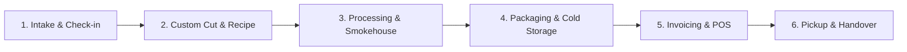

Wild Game Butcher (WGB) is a specialized cloud platform built for wild game processing facilities, custom butcher shops, and commercial meat processors. The platform streamlines every step of the wild game lifecycle—from harvest intake and state regulatory compliance to custom recipe processing, cold storage management, and point-of-sale checkout.

## Platform pillars

The WGB ecosystem is structured across four primary functional domains:

<Columns cols={2}>
  <Card title="Store onboarding and configuration" icon="store" href="/onboarding/store-setup">
    Configure shop locations, regulatory compliance tags, custom species catalogs, cutting rates, and staff permissions.
  </Card>
  <Card title="Order intake workflow" icon="clipboard-check" href="/workflows/customer-intake">
    Verify hunting licenses, log carcass tags, capture hanging weights, and configure custom cuts with advance deposits.
  </Card>
  <Card title="Shop floor operations" icon="gear" href="/workflows/service-processing">
    Manage shop queues across skinning, caping, cutting, batch grinding, sausage seasoning, and walk-in freezer storage.
  </Card>
  <Card title="Invoicing and customer pickup" icon="receipt" href="/workflows/invoicing-and-payments">
    Automate yield-based billing, calculate late storage fees, send multi-channel notifications, and complete counter handover.
  </Card>
</Columns>

## Core user roles

WGB provides granular role-based access control (RBAC) to ensure staff members access only the operational modules they require:

| Role | Primary Responsibilities | Accessible Modules |
| :--- | :--- | :--- |
| **Butcher Admin / Owner** | Store configuration, pricing rates, billing subscription, staff roles, reporting | Full platform access, Store Settings, Subscription, User Management |
| **Intake / Front Desk Staff** | Hunter check-in, license verification, order customization, advance deposit collection | Customer Management, Order Creation, Cart Layout, Invoicing & POS |
| **Shop Floor Butcher / Processor** | Carcass hanging, skinning, caping, primal cutting, burger grinding, sausage stuffing | Service Processing, Product Processing, Operational Notes |
| **Packaging & Freezer Staff** | Vacuum sealing, portion labeling, freezer bin allocation, pickup verification | Order Packaging, Cold Storage Tracking, Pickup Management |

## Application workflow roadmap

Follow the core operational lifecycle through each stage of the wild game processing journey:

<Steps>
  <Step title="Store setup and catalog configuration">
    Set up your shop profile, tax rates, regulatory compliance rules, species-service matrix, and staff roles in [Store Setup](/onboarding/store-setup).
  </Step>
  <Step title="Customer intake and harvest check-in">
    Log customer contact details, verify state hunting licenses, record carcass tags, and measure hanging weight in [Customer Intake](/workflows/customer-intake).
  </Step>
  <Step title="Customization and order confirmation">
    Configure custom cuts, grind ratios, specialty sausage flavors, packaging preferences, and collect advance deposits in [Order Customization](/workflows/order-customization).
  </Step>
  <Step title="Service and product processing">
    Track carcasses through skinning, aging, cutting, grinding, and smoking with real-time status updates in [Service Processing](/workflows/service-processing) and [Product Processing](/workflows/product-processing).
  </Step>
  <Step title="Packaging and cold storage management">
    Seal meat portions, assign freezer bins, and monitor grace period storage countdowns in [Packaging & Storage](/workflows/packaging-and-storage).
  </Step>
  <Step title="Invoicing, notification and pickup">
    Generate yield-accurate invoices, dispatch automated SMS and email alerts, collect final payments, and record hand-offs in [Invoicing & Payments](/workflows/invoicing-and-payments).
  </Step>
</Steps>
