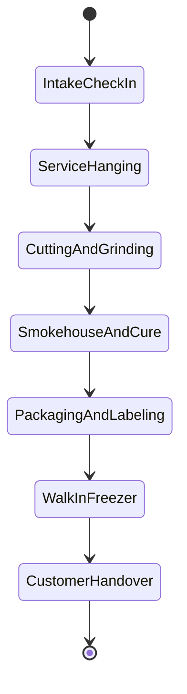
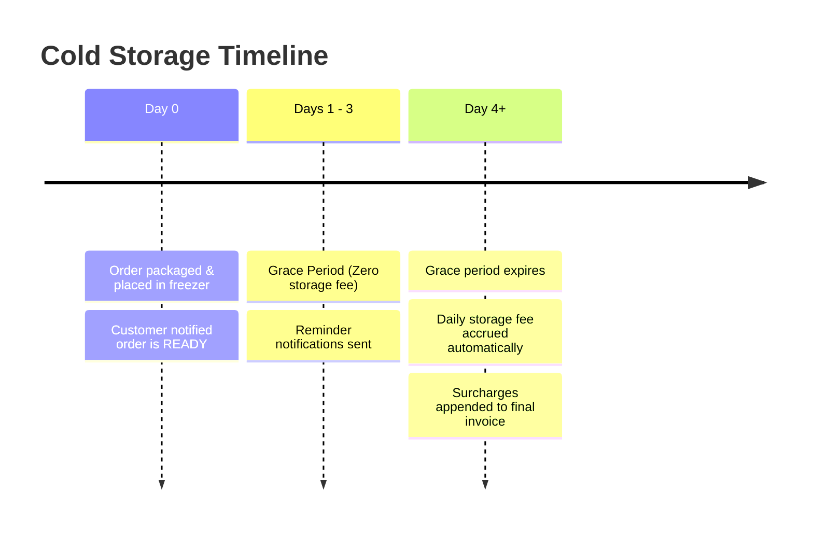

Efficient shop throughput depends on standardized operational stages, clear staff accountability, and automated cold storage tracking.

## Operational checkpoints

Navigate to **Operation Management** to define and sequence the checkpoints each order passes through:

### Standard operational milestones
1. **Intake & Check-In**: Carcass tagged, hung on the rail, and entered into system.
2. **Skinning & Caping**: Hide removed; cape frozen or tagged for taxidermist.
3. **Cooler Aging**: Carcass hanging in temperature-controlled cooler.
4. **Cutting Floor**: Primal cuts separated into steaks, roasts, and trim.
5. **Grind & Mix**: Meat weighed, fat ratio blended, and seasoned.
6. **Smokehouse**: Thermal cooking and wood smoke cycles for sausage batches.
7. **Packaging & Freezing**: Portioning, sealing, and blast freezing.
8. **Storage Bin Allocation**: Packed boxes organized into numbered freezer bins.

## Role-based access control (RBAC)

Ensure team members only access tools appropriate for their responsibilities under **User Management** and **Role Management**:

### Default roles and module permissions

<AccordionGroup>
  <Accordion title="Store Administrator" defaultOpen={true}>
    * Full access across all modules, including financial reports and billing settings.
    * Can create, edit, and delete catalog items, service rates, and staff accounts.
    * Access to system audit logs and revenue dashboards.
  </Accordion>

  <Accordion title="Front Desk / Intake Specialist">
    * Access to **New Order Creation**, **Customer List**, and **Cart Layout**.
    * Permitted to create orders, verify hunting licenses, and record advance payments.
    * Restricted from modifying base pricing rates, tax configurations, or store settings.
  </Accordion>

  <Accordion title="Shop Floor Butcher / Processor">
    * Access to **Service Processing** and **Product Processing** task queues.
    * Can update work task status (`New` -> `In Progress` -> `Completed`) and add operational notes.
    * Restricted from viewing customer financial balances or processing subscription payments.
  </Accordion>

  <Accordion title="Packaging and Fulfillment Specialist">
    * Access to **Order Packaging**, **Pickup List**, and **Invoicing**.
    * Can verify box counts, generate pickup receipts, and record final customer handovers.
  </Accordion>
</AccordionGroup>

## Cold storage policies & grace periods

Walk-in freezer space is a butcher's most constrained resource during peak hunting seasons. WGB features automated cold storage fee calculation under **Storage Cost**:

### Storage policy parameters
* **Grace Period Days**: The number of free days a customer is allowed to pick up completed orders after being notified (typically 3 to 7 calendar days).
* **Daily Storage Rate**: The dollar fee assessed per day (`daily_rate`) once the grace period expires (e.g., $5.00/day per order or per box).
* **Maximum Notification Threshold**: Number of automated warning alerts sent before late storage penalties take effect.

<Tip>
  Storage charges automatically appear as dedicated line items in `InvoiceStorageCostDetail` when the invoice is finalized at pickup.
</Tip>
