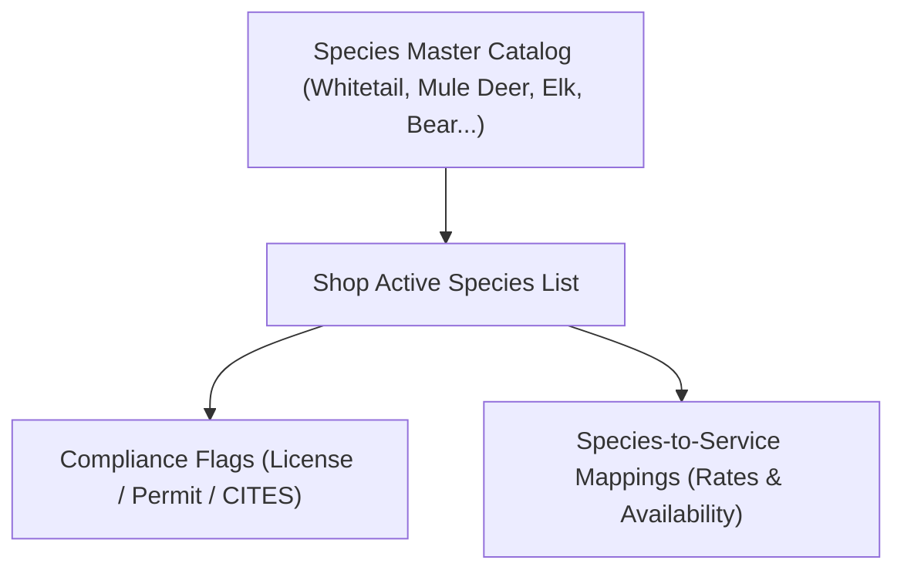

Wild game meat processors operate under strict state Department of Natural Resources (DNR), fish & game, and federal wildlife compliance regulations. Wild Game Butcher provides a flexible species catalog combined with automated compliance enforcement.

## Managing accepted species

Access **Species Settings** > **Species** to view and configure the animals your facility is licensed and equipped to process:

### Adding a species to your shop
1. Click **Add Species** in the top-right corner.
2. Select from the master species catalog (for example: *White-Tailed Deer*, *Mule Deer*, *Elk*, *Black Bear*, *Wild Boar*, *Antelope*).
3. Set the species status to **Active**.
4. Configure mandatory compliance verification flags for this species.

## Compliance flags and regulatory controls

Each species card features compliance flags that dynamically alter the [Customer Intake](/workflows/customer-intake) form requirements:

<AccordionGroup>
  <Accordion title="License Flag (Hunting license verification)" defaultOpen={true}>
    When enabled, intake staff cannot submit an order without entering and verifying the hunter's state-issued hunting license number and issuing state.
    
    * **Enforcement**: Validated during Step 1 of order creation.
    * **Audit record**: Saved in `HuntingLicence` and linked to the customer profile.
  </Accordion>

  <Accordion title="Permit Flag (Game harvest tag / Confirmation code)">
    Requires the recording of state harvest confirmation numbers, carcass confirmation tags, or special game zone permits.

    * **Enforcement**: Requires carcass tag number and harvest county/game management unit.
    * **Audit record**: Stored in `OrderCheckIn` and printed directly onto carcass tags.
  </Accordion>

  <Accordion title="CITES Flag (Federal wildlife tracking)">
    Required for regulated species such as Black Bear, Mountain Lion, or imported trophies that fall under the Convention on International Trade in Endangered Species (CITES).

    * **Enforcement**: Prompts for official federal export/tag documentation numbers.
    * **Audit record**: Retained in permanent store logs to satisfy state wildlife agency audits.
  </Accordion>
</AccordionGroup>

<Warning>
  **Important compliance alert**: When updating species compliance flags, existing pending orders retain their original intake rules. If you deactivate a species currently in the shop floor queue, staff can still complete active orders, but new intakes for that species will be blocked.
</Warning>

## Species-to-service mapping

Different animals require distinct cutting styles, skinning protocols, and aging durations. Use **Species Settings** > **Species-Service** to configure which services apply to each species:

1. Select a species (such as *Elk*).
2. Choose services available for this animal:
   * **Skinning & Caping**: Define whether trophy caping is supported for this species.
   * **Standard Processing**: Set base cutting and deboning rates.
   * **Hanging & Aging**: Set recommended temperature and maximum hang days.
3. Configure specific pricing overrides (for example, charging a different per-pound cutting rate for Elk compared to White-tailed Deer).
4. Click **Save Mappings**.
