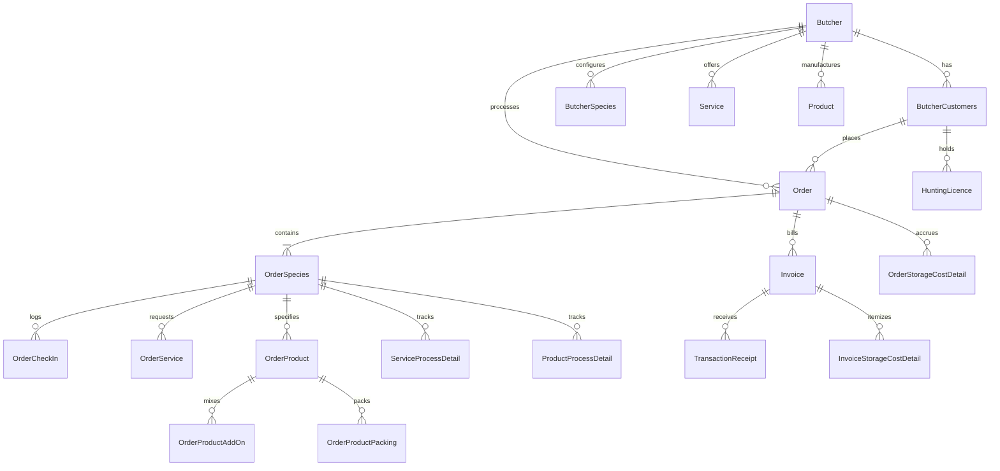

The Wild Game Butcher backend utilizes Prisma ORM with PostgreSQL. The database is divided into two distinct database schemas: `app` (platform administrative data, subscriptions, and system lookups) and `butcher` (multi-tenant store operational data, customers, and orders).

## Entity relationship diagram

## Core database entities

### Order (`butcher.orders`)
The top-level transaction entity representing a hunter's visit:
* `id` (Int, PK): Unique auto-incrementing order identifier.
* `butcherId` (Int): Tenant isolation key.
* `customerId` (Int): Foreign key to `ButcherCustomers`.
* `speciesId` (Int): Primary species reference.
* `orderNumber` (String, Unique): Human-readable order code (e.g., `WGB-2026-0842`).
* `quantity` (Int): Number of carcasses or heads in the order.
* `orderDate` (DateTime): Intake check-in timestamp.
* `estCompleteDate` (DateTime): Estimated date of completion.
* `priority` (Int): Priority ranking (0 = standard, 1 = expedited rush).
* `status` (Int): Master order lifecycle state integer.
* `advancePayment` (Float): Deposit collected at intake.
* `advancePaymentBalance` (Float): Remaining deposit balance.
* `productsCompletedDate` (DateTime): Timestamp when final meat products are finished, starting the cold storage countdown.

### OrderSpecies (`butcher.order_species`)
Represents individual animals within multi-carcass orders:
* `id` (Int, PK): Unique animal identifier.
* `orderId` (Int): Parent order reference.
* `speciesTag` (String): Specific carcass identification tag or gambrel label.
* `status` (Int): Processing status of this specific animal.
* `paymentStatus` (Int): Payment tracking state.

### OrderCheckIn (`butcher.order_check_in`)
Harvest and inspection audit record:
* `licenseNumber` (String): Hunter's state DNR wildlife license.
* `harvestDate` (DateTime): Date animal was harvested in the field.
* `harvestCounty` (String): State and county or hunting unit.
* `hangingWeight` (Float): Raw weight recorded at hanging rail inspection.
* `antlerScore` & `antlerPoints` (String / Int): Trophy rack notes.
* `customerSignature` (String): Base64 digital signature string captured at counter intake.

### OrderService (`butcher.order_service`)
Specific carcass labor items:
* `serviceId` (Int): Foreign key to configured `Service`.
* `serviceFeeTypeId` (Int): Flat rate, per-pound, or hourly billing model.
* `serviceRate` (Float): Dollar rate applied.
* `status` (Int): `0` = New, `1` = Started, `2` = Complete.

### OrderProduct (`butcher.order_product`)
Finished meat products, cuts, and sausages:
* `productId` (Int): Foreign key to `Product`.
* `weight` (Float): Actual net finished weight recorded by cutting staff.
* `status` (Int): `0` = New, `1` = In Progress, `2` = Complete, `3` = Invoiced, `4` = Paid.

## Order status state machine

The master `Order.status` field governs the overall progression of an order through the shop:

| Status Code | Status Constant | Description | Trigger / Action |
| :---: | :--- | :--- | :--- |
| **0** | `NEW` | Order created at intake; carcass hung on rail | Order created via `POST /butcher/order/create` |
| **1** | `STARTED` | Carcass skinning or caping commenced | Shop butcher clicks **Start Service** |
| **2** | `PROCESSING` | Carcass deboning, cutting, or sausage grinding underway | First product task marked **In Progress** |
| **3** | `READY_TO_INVOICE` | All cutting, grinding, and smoking completed | All products marked `COMPLETE (2)` |
| **4** | `PARTIALLY_PICK_UP_READY` | Split order: portions completed and frozen | Sub-batches finished in multi-animal order |
| **5** | `PARTIALLY_PICKED_UP` | Hunter collected preliminary cuts (e.g. steaks) | Partial counter handover recorded |
| **6** | `PICK_UP_READY` | Fully packaged, frozen in bin, invoice paid | Invoice finalized & marked `PAID` |
| **7** | `PICKED_UP` | Final customer handover complete | Staff clicks **Mark as Picked Up** |

## Sub-entity status state machine

Individual services and products maintain granular sub-statuses:

<Tabs>
  <Tab title="Service statuses">
    * `0` - **New**: Service queued for shop floor attention.
    * `1` - **In Progress**: Butcher actively skinning, caping, or aging carcass.
    * `2` - **Complete**: Carcass service work completed.
    * `3` - **Invoiced**: Service charge compiled onto active invoice.
    * `4` - **Paid**: Final service payment settled.
  </Tab>
  <Tab title="Product statuses">
    * `0` - **New**: Cut profile queued for cutting floor.
    * `1` - **In Progress**: Deboning, grinding, or smokehouse cycle running.
    * `2` - **Complete**: Finished weight recorded and meat packaged.
    * `3` - **Invoiced**: Added to customer invoice ledger.
    * `4` - **Paid**: Product payment confirmed.
  </Tab>
  <Tab title="Invoice statuses">
    * `1` - **Invoiced**: Draft invoice generated; awaiting customer payment.
    * `2` - **Paid**: Payment collected via POS or online credit card checkout.
    * `3` - **Picked Up**: Meat boxes released from freezer and handed to hunter.
  </Tab>
</Tabs>
