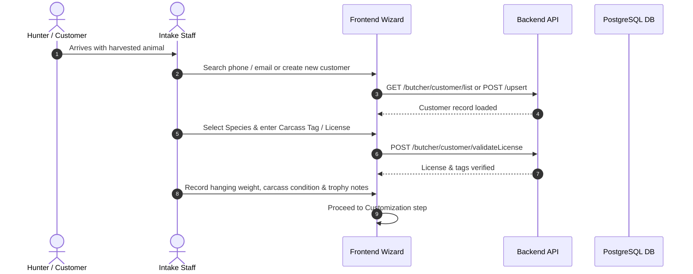

Order creation begins at the intake dock or front counter. Staff members use the **New Order** intake wizard to capture customer contact data, verify wildlife compliance tags, and register arriving carcasses.

## Step 1: Hunter identification

Access the intake workflow by clicking **New Order** in the main navigation.

### Existing customer lookup
1. Type the hunter's phone number, email address, or name into the search bar.
2. Select the matching customer profile.
3. Review contact details to ensure phone and email are current for automated pickup notifications.

### Registering a new customer
If the customer is visiting your facility for the first time:
1. Click **Create New Customer**.
2. Complete mandatory customer fields:
   * First and last name.
   * Primary mobile phone number (used for SMS pickup alerts).
   * Email address (used for digital invoice delivery).
   * Residential mailing address.
3. Click **Save & Continue**.

## Step 2: Regulatory compliance verification

Based on the [Species Compliance Configuration](/onboarding/species-catalog), the system enforces mandatory legal documentation checks:

<Tabs>
  <Tab title="Hunting license">
    * **License Number**: Enter the hunter's active state DNR or wildlife agency license ID.
    * **Issuing State**: Select the state that granted the hunting license.
    * **Validation**: The system checks for existing active licenses on file or creates a new `HuntingLicence` record.
  </Tab>
  <Tab title="Harvest permit and confirmation tag">
    * **Tag / Confirmation Number**: Record the game harvest tag number or DNR telecheck code affixed to the animal.
    * **Harvest Date & Location**: Enter the date of harvest and county / wildlife management unit (WMU).
    * **Tag Type**: Specify if it is a general tag, landowner permit, or antlerless allocation.
  </Tab>
  <Tab title="CITES and trophy documentation">
    * For regulated predators or imported species (such as Bear or Mountain Lion), input federal CITES seal numbers or export permit identifiers.
  </Tab>
</Tabs>

## Step 3: Carcass inspection & check-in details

Inspect the arriving animal and enter physical characteristics into **Order Check-In**:

<Columns cols={2}>
  <Card title="Physical Measurements" icon="weight-scale">
    * **Intake Hanging Weight (lbs)**: Record scale weight as weighed on the hanging rail.
    * **Carcass Condition**: Mark whether the animal is whole field-dressed, quartered, skinned, or boneless trim.
  </Card>
  <Card title="Trophy and Disposition" icon="trophy">
    * **Head / Antlers**: Record antler score, number of points, or whether the hunter is retaining the head.
    * **Hide / Caping**: Indicate whether the hide is retained, donated, or flagged for cape preservation.
  </Card>
</Columns>

### Intake notes & special handling
Add operational comments directly to the check-in form:
* Bullet wound damage notes (e.g., *"Right front shoulder heavy shot damage; bone out for grind"*).
* Field care quality (e.g., *"Clean shot, cooled on ice, excellent carcass condition"*).
* Taxidermist destination (e.g., *"Cape saved for Johnson Taxidermy; customer will collect cape Thursday"*).

Click **Continue to Customization** to specify cut instructions and recipes.
