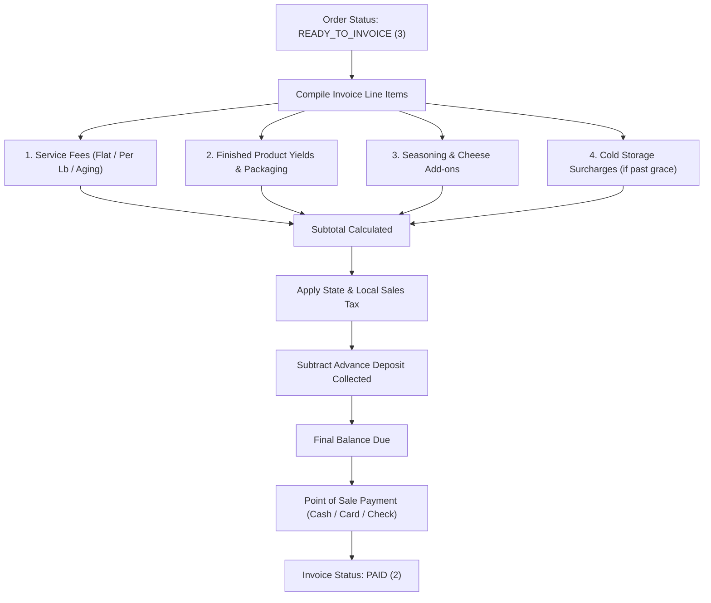

When all services and cutting operations are completed, the order enters the invoicing and billing stage. The **Invoicing** module reconciles labor, yields, add-ons, storage fees, and advance deposits into an itemized customer invoice.



## Creating an invoice

Access ready orders via **Invoice** > **Invoice List** (filtered by `READY_TO_INVOICE`):

1. Click on the order to open **Create Invoice** (`POST /butcher/invoice/createInvoice`).
2. The system queries all recorded yields, service rates, and mix-in add-ons within an atomic database transaction.
3. Review the itemized billing categories:

<Tabs>
  <Tab title="Services line items">
    * Base cutting & deboning fee (flat rate or hanging weight calculation).
    * Specialty caping fee (if shoulder mount was prepared).
    * Cooler aging surcharges (if extra aging days were requested).
    * Waste disposal fee.
  </Tab>
  <Tab title="Products and yields">
    * Actual finished weights recorded on the cutting floor:
      * *Steaks & roasts ($0.00 base cutting or specialty per-lb rate)*.
      * *Ground burger chubs (yield in lbs)*.
      * *Smoked summer sausage chubs (finished weight in lbs)*.
      * *Snack sticks (finished weight in lbs)*.
  </Tab>
  <Tab title="Add-on ingredients">
    * Added pork trim / beef fat pounds.
    * High-temp cheddar and pepperjack cheese pounds.
    * Seasoning packet charges.
  </Tab>
  <Tab title="Packaging materials">
    * Vacuum seal packaging surcharge (per package count or total poundage).
    * Heavy duty freezer paper wrap.
  </Tab>
  <Tab title="Cold storage charges">
    * Daily storage fees accrued past the free grace period threshold (`invoice_storage_cost_detail`).
  </Tab>
</Tabs>

## Advance deposit deduction and taxes

The invoice calculation engine automatically applies payments and taxes:

```math
\text{Total Invoice Amount} = (\text{Services} + \text{Products} + \text{Addons} + \text{Packaging} + \text{Storage}) \times (1 + \text{Tax Rate})
```

```math
\text{Balance Due} = \text{Total Invoice Amount} - \text{Advance Deposit Paid}
```

* **Advance Deposit Reconciliation**: The original advance payment recorded at check-in (`advance_payment`) is deducted from the invoice total.
* **Taxes**: Applied to taxable goods (such as retail packaging, seasonings, and taxable processing services according to state tax settings).

## Point of sale payment capture

When the customer arrives at the counter or pays online:

1. Click **Mark as Paid** (`POST /butcher/invoice/markAsPaid`).
2. Select payment tender:
   * **Credit / Debit Card**: Process via integrated merchant terminal or Stripe payment link.
   * **Cash**: Enter amount tendered and calculate exact change.
   * **Check**: Enter check number for accounting reconciliation.
3. The invoice status advances to `PAID (2)`.
4. The system updates order status to `PICK_UP_READY (6)`.
5. A thermal payment receipt and itemized digital invoice PDF are generated automatically.
