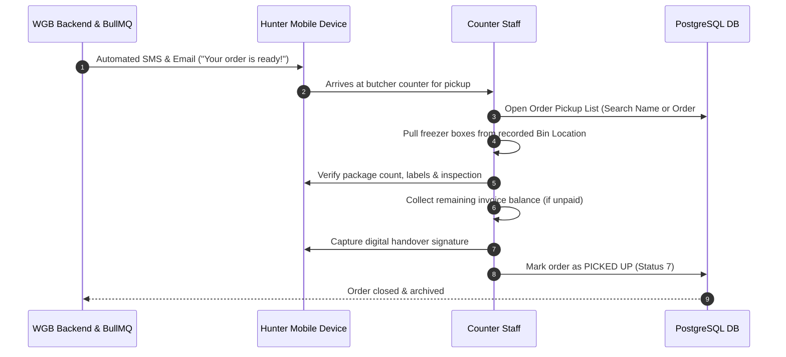

The final stage of the wild game processing journey is notifying the hunter and executing an orderly, verified pickup at the counter.

## Multi-channel automated notifications

WGB integrates an automated notification pipeline powered by **BullMQ** and background worker queues:

<AccordionGroup>
  <Accordion title="1. Order ready notification" defaultOpen={true}>
    Dispatched immediately when products are packaged, frozen, and the invoice is created.
    
    * **Channels**: SMS text message and HTML email.
    * **Content**: Order number, customer name, total box count, itemized balance due, and the exact date and time the free grace period expires.
    * **Payment Link**: Includes a secure link allowing the hunter to pay their balance online before arriving.
  </Accordion>

  <Accordion title="2. Grace period reminder alert">
    Dispatched 24 to 48 hours before the free cold storage grace period concludes.
    
    * **Urgency alert**: Reminds the hunter to collect their meat to avoid daily freezer storage surcharges.
  </Accordion>

  <Accordion title="3. Storage fee notice">
    Sent if an order enters daily storage surcharge status, detailing the daily rate accruing on the order.
  </Accordion>
</AccordionGroup>

### Resending notifications
If a hunter reports missing their pickup notice, counter staff can click **Resend Notification** (`POST /butcher/invoice/resendNotification`) from the invoice screen to re-dispatch SMS and email alerts instantly.

## The pickup and handover procedure

Navigate to **Pickup** > **Order Pickup List**:

<Steps>
  <Step title="Look up the order">
    Search by customer name, order number, or scan the customer's check-in receipt barcode.
  </Step>

  <Step title="Locate freezer storage boxes">
    The pickup screen prominently highlights the freezer bin location (e.g., `FRZ-B-S2-B08`) and the total number of boxes (e.g., *2 Boxes*).
    
    * Staff retrieve all matching boxes from the walk-in freezer.
  </Step>

  <Step title="Package verification and customer inspection">
    Open the boxes with the customer to verify contents:
    * Confirm all requested steaks, roasts, burger chubs, and specialty sausage packs are accounted for.
    * Verify carcass tags and hunter identification numbers printed on each pack match the order.
    * If a taxidermy cape or antlers were retained, retrieve them from the cold storage cape room.
  </Step>

  <Step title="Balance payment check">
    If the invoice was not prepaid online, complete payment collection at the counter terminal.
  </Step>

  <Step title="Handover signature and completion">
    Capture the customer's final pickup signature confirming receipt in satisfactory condition.
    
    Click **Mark as Picked Up** (`POST /butcher/pickup/markAsPickedUp`):
    * The order status updates to `PICKED_UP (7)`.
    * The invoice status updates to `PICKEDUP (3)`.
    * The freezer bin is freed for incoming orders.
    * The order lifecycle is officially complete.
  </Step>
</Steps>
