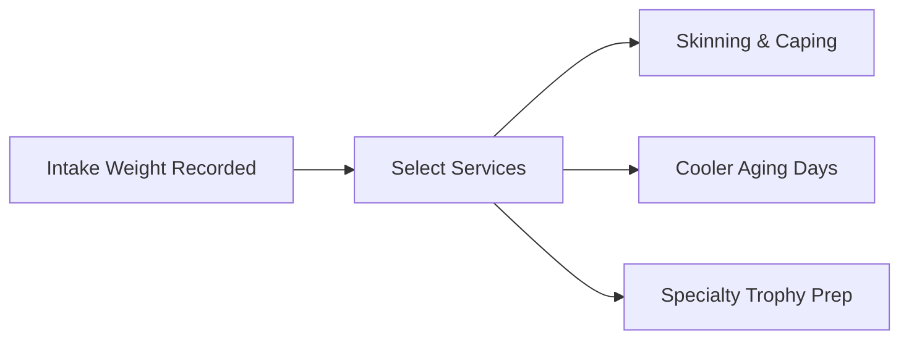

Once intake inspection is complete, staff work with the hunter to tailor cutting instructions and sausage recipes to their culinary preferences.

## Step 4: Service selection & carcass treatment

Select the carcass labor services applicable to the animal:

* **Standard Processing**: Standard deboning, steak trimming, roast preparation, and packaging.
* **Trophy Caping**: Careful head and shoulder hide removal preserving the face for shoulder taxidermy mounts.
* **Cooler Aging**: Select requested hang time in the aging cooler (e.g., 5 to 10 days) to tenderize muscle fibers before cutting.
* **Waste Disposal Fee**: Standard state regulatory biological waste removal.

## Step 5: Product cuts and processing recipes

Select desired cuts across the primal sections of the animal:

<Tabs>
  <Tab title="Steaks and roasts">
    * **Backstrap / Loin**: Choose whole roasts, bone-in chops, or boneless butterfly steaks (specify cut thickness: 3/4" or 1").
    * **Tenderloins**: Whole muscle or medallion steaks.
    * **Sirloins & Rounds**: Sizzler steaks, whole roasts, London broil, or convert entirely to ground burger / jerky.
    * **Shoulder / Chuck**: Pot roasts, stew meat cubes, or boneless sausage trim.
  </Tab>
  <Tab title="Burger and grind blends">
    Wild game meat is exceptionally lean (under 3% fat). Customers choose fat blend ratios to achieve optimal moisture:
    * **Straight Game Grind (100% Lean)**: No fat added.
    * **80/20 Venison / Pork Fat**: High-moisture blend recommended for juicy burgers.
    * **85/15 Venison / Beef Suet**: Traditional rich flavor blend.
  </Tab>
  <Tab title="Specialty sausages and smokehouse">
    Customers can allocate boneless trim pounds toward batch smoked goods:
    * **Summer Sausage**: Traditional, Garlic, or Jalapeño Cheddar logs.
    * **Snack Sticks**: Pepperoni, Teriyaki, Honey BBQ, or Habanero sticks.
    * **Smoked Bratwursts**: German-style, Beer brats, or Cheddar jalapeño links.
  </Tab>
</Tabs>

## Step 6: Recipe add-ons and seasonings

For sausage and specialty burger batches, apply premium mix-in ingredients:

* **High-Temp Diced Cheeses**: Select High-Temp Cheddar, Pepperjack, or Mozzarella. High-temp cheeses withstand smokehouse internal temperatures up to 400°F without melting into liquid.
* **Specialty Spices & Seasonings**: Add cracked black pepper, red pepper flakes, or custom garlic blends.
* **Bacon Ends & Pieces**: Premium smoky bacon trim blended into burger grinds.

<Note>
  Batch minimums are enforced automatically. If a customer requests *Jalapeño Cheddar Snack Sticks*, the platform requires a minimum batch size (e.g., 10 lbs) to ensure smokehouse efficiency.
</Note>

## Step 7: Packaging specifications

Specify portion sizes and wrapping materials for each cut:

| Product Category | Standard Packaging Style | Available Pack Sizes |
| :--- | :--- | :--- |
| **Steaks & Chops** | Vacuum Seal (Heavy 4 Mil) | 2 steaks / pack or 4 steaks / pack |
| **Roasts** | Vacuum Seal | 2 - 3 lbs individual roasts |
| **Ground Meat** | Poly Chub Bags with Tape Seal | 1 lb chubs or 2 lb chubs |
| **Stew Meat & Fajita** | Vacuum Seal | 1 lb packs |
| **Snack Sticks** | Vacuum Seal (Zip Resealable) | 1 lb packs (approx. 8-10 sticks) |
| **Summer Sausage** | Mahogany Fibrous Casings | 1.5 lb whole chubs |

Click **Review Order Summary** to proceed to payment and check-in confirmation.
