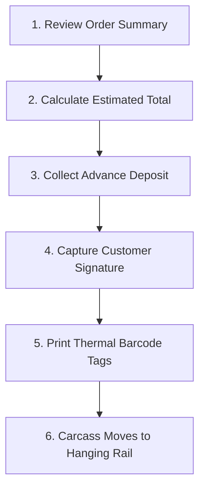

Before the animal moves from the intake dock to the walk-in hanging cooler, staff finalize the order, collect an advance deposit, and attach tracking tags.



## Step 8: Order summary review

Review the complete order configuration in the **Order Summary** view:

* **Customer & Harvest Details**: Confirm contact information, license number, carcass tag, and intake hanging weight.
* **Selected Services**: List of base processing, caping, and cooler aging charges.
* **Product Estimates**: Estimated yields based on hanging weight formulas (standard bone-in deer yields approximately 40-50% boneless meat).
* **Packaging & Add-on Costs**: Breakdown of specialty vacuum packaging fees, sausage seasoning charges, and fat trim additions.
* **Estimated Order Total**: Preliminary estimate provided to the customer.

<Note>
  **Final vs. Estimated Billing**: Because sausage batch additions, trim yields, and smokehouse weights vary, the final invoice total is calculated after cutting floor completion. The estimate provides transparency to the hunter at check-in.
</Note>

## Step 9: Advance deposit collection

Butcher shops require advance deposits to protect against uncollected meat orders:

1. Locate the **Advance Payment** field in the order summary.
2. Enter the deposit amount collected (standard store policies typically require $50.00 to $100.00 per animal).
3. Select payment method:
   * **Cash**
   * **Credit / Debit Card** (integrated card terminal or external POS)
   * **Check** (record check number)
4. The system updates `advancePayment` and records `advancePaymentBalance` on the `Order` record.

## Step 10: Customer digital signature

To ensure legal compliance and agreement with cutting instructions:

1. Present the counter signature pad or tablet screen to the hunter.
2. The customer reviews:
   * Cutting selections and sausage flavor choices.
   * Acknowledgment of wild game non-inspection regulations.
   * Agreement to shop [Cold Storage Policies](/onboarding/operations-and-roles) and grace period pickup deadlines.
3. The customer signs digitally. The signature is embedded directly into the check-in receipt document.

## Step 11: Barcode carcass tag generation

Click **Complete Order & Print Tag** to generate thermal hanging tags:

```
+-------------------------------------------------------+
|  WILD GAME BUTCHER - INTAKE TAG                       |
|  Order #: WGB-2026-0842      Date: 2026-11-24         |
|  Customer: John Doe         Phone: (555) 234-5678    |
|  Species: White-Tailed Deer  Weight: 142 lbs          |
|  DNR Tag: 839201948         License: WI-4920492       |
|  Services: Standard Process + Cape for Mount         |
|                                                       |
|  ||| | ||||| |||| |||| |||||| ||||| |||| |||          |
|  *WGB-2026-0842-01*                                   |
+-------------------------------------------------------+
```

### Affixing tags
* **Carcass Rail Tag**: Heavyweight waterproof tag affixed directly to the gambrel or hind hock with a zip tie.
* **Cape / Head Tag**: Duplicate weather-resistant tag attached through the ear or antler base if trophy caping was ordered.
* **Customer Receipt**: Thermal receipt or digital email copy provided to the hunter with their order tracking number.

The order now transitions to status **New (0)** and enters the [Service Processing](/workflows/service-processing) queue.
