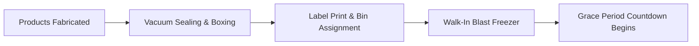

Once cutting and smokehouse cycles conclude, processed meats are vacuum-sealed, portion-labeled, boxed, and transferred to the commercial walk-in blast freezer.



## Packaging and portion labeling

Navigate to **Order Packaging** to process finished cuts:

1. **Packaging Station**:
   * Inspect each package to ensure airtight vacuum seals.
   * Verify poly burger chubs are tightly clipped with hog rings or heavy freezer tape.
2. **Thermal Label Application**:
   Each individual meat package receives a custom compliance label printed on water-resistant thermal stock:

```
+-------------------------------------------------------+
|  NORTHERN SHORES WILD GAME PROCESSING                 |
|  Customer: John Doe         Order #: WGB-2026-0842   |
|  Product: Venison Backstrap Medallions                |
|  Packaging Date: 2026-11-28   Pack Weight: 1.84 lbs   |
|  "NOT FOR SALE - CUSTOM HARVESTED WILD GAME MEAT"     |
|  Keep Frozen at 0°F (-18°C) or Below                  |
+-------------------------------------------------------+
```

## Freezer bin allocation

To ensure rapid customer hand-off when hunters arrive for pickup:

1. Finished meat packages are packed into heavy-duty corrugated freezer boxes.
2. Each box is assigned a specific freezer bin or pallet location (e.g., *Freezer A - Shelf 3 - Bin 14*).
3. The bin identifier is recorded in the order packaging interface:
   * **Total Boxes**: e.g., 3 Boxes.
   * **Bin Location**: `FRZ-A-S3-B14`.
4. The bin location is automatically printed on the customer pickup receipt and displayed in the counter checkout screen.

## Automated cold storage management

Walk-in freezer capacity is essential for maintaining smooth processing flow during peak hunting season. WGB automates cold storage enforcement:

### The cold storage lifecycle

<Steps>
  <Step title="Completion clock starts">
    When all products are marked `COMPLETE`, the backend records `productsCompletedDate` in the database.
  </Step>

  <Step title="Grace period active (Days 0 to 3)">
    The customer receives an automated SMS and email notification alerting them that their order is packaged and frozen.
    * No storage fees accrue during the grace period (e.g., first 3 calendar days).
    * Daily reminder notifications inform the hunter of the upcoming deadline.
  </Step>

  <Step title="Grace period expires (Day 4+)">
    If the order remains uncollected after the grace period:
    * The daily storage cost background job (`calculateStorageCosts`) activates automatically.
    * The system evaluates each calendar day past the grace threshold.
    * Daily fees (`daily_rate` configured in [Cold Storage Policies](/onboarding/operations-and-roles)) append to the order's storage ledger (`OrderStorageCostDetail`).
  </Step>

  <Step title="Storage fee line items on invoice">
    When the customer arrives to pick up meat, storage fees appear as distinct itemized rows on their invoice:
    * *Example: "Cold Storage Surcharge (4 days past grace period @ $5.00/day) = $20.00"*.
  </Step>
</Steps>

<Warning>
  **Customer communication tip**: Automated notifications clearly state the exact date and time the free grace period expires to prevent disputes at the pickup counter.
</Warning>
