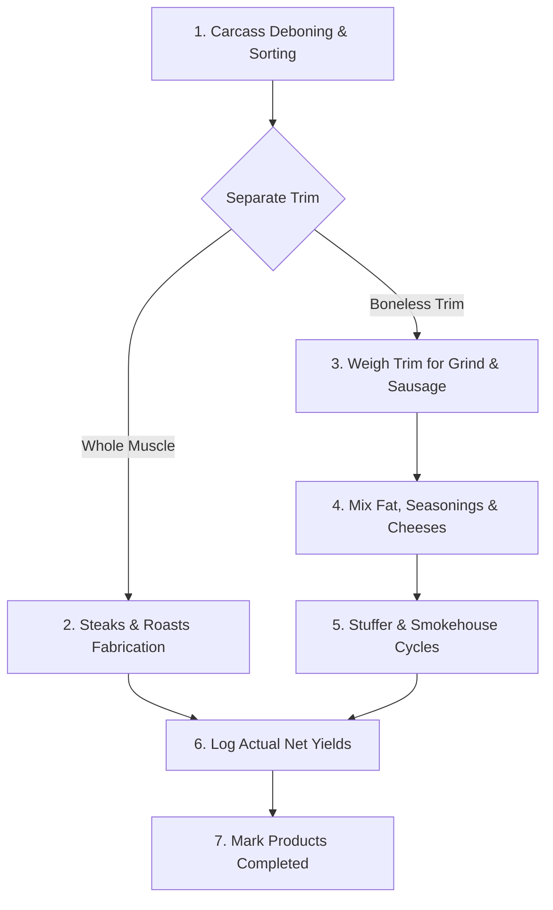

The **Product Processing** module manages boning tables, commercial meat grinders, vacuum tumblers, sausage stuffers, and commercial smokehouses.

## Product processing task list

Access the cutting floor queue via **Product Processing** > **Product Processing List**:

The screen organizes work into two operational perspectives:
1. **Order View**: Complete list of cuts requested for a single hunter's animal.
2. **Batch View (Aggregate Grinding & Smokehouse Runs)**: Aggregates boneless trim across multiple orders sharing the same recipe (for example: combining trim from 8 deer to run a single 100 lb batch of *Cheddar Jalapeño Summer Sausage*).

## Step-by-step product execution

<Steps>
  <Step title="Deboning and steak fabrication">
    Butchers pull aged carcasses from the cooler onto cutting tables. Backstraps, tenderloins, and round roasts are fabricated according to the customer's specified cut style and steak thickness.
  </Step>

  <Step title="Weighing trim and batching sausage recipes">
    Remaining boneless muscle meat is trimmed of sinew and weighed on certified legal-for-trade scales:
    * Boneless venison trim is allocated to burger grinds or specialty sausage formulations.
    * The operator enters the exact boneless trim weight into the system.
  </Step>

  <Step title="Blending fat ratios and mix-in add-ons">
    For sausage and burger recipes:
    * The operator weighs required pork trim or beef suet to achieve the customer's chosen ratio (80/20 or 85/15).
    * High-temp cheddar or pepperjack cheese and spices are weighed and blended in vacuum paddle mixers.
    * Add-on inventory quantities are updated.
  </Step>

  <Step title="Smokehouse cooking and chilling">
    Stuffed summer sausages, snack sticks, and cured meats are loaded into computer-controlled smokehouses:
    * Natural hardwood smoke cycle (hickory or applewood).
    * Core thermal probe tracks internal cooking temperature until pathogens are neutralized.
    * Cold shower chill cycle locks casing shape before packaging.
  </Step>

  <Step title="Recording final net yields">
    The cutting floor operator records the exact finished weight for each product line item:
    * Actual pounds of vacuum-sealed steaks.
    * Actual pounds of finished ground burger chubs.
    * Actual pounds of smoked sausages.
  </Step>

  <Step title="Marking products as completed">
    Click **Complete Product** on each finished line item. When all products for the order are marked `COMPLETE (2)`:
    * The system records `productsCompletedDate` on the master order record.
    * This timestamp automatically activates the [Cold Storage Grace Period](/workflows/packaging-and-storage).
    * The order status updates to `READY_TO_INVOICE (3)`.
  </Step>
</Steps>

## Operational notes & reopening products

* **Product Notes**: Staff add operational comments (`POST /butcher/productProcess/note`) such as *"Yield was lower than average due to shoulder bullet fragmentation; 8 lbs ground burger produced"*.
* **Reopening a Product**: If an additional batch was omitted or seasoning adjustment is required, click **Reopen Product** (`POST /butcher/productProcess/reopenProduct`). The order status reverts from Ready to Invoice back to `PROCESSING (2)`.
