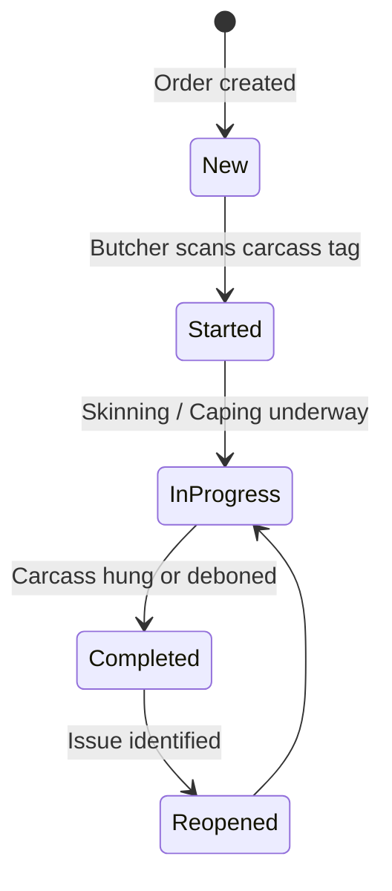

The **Service Processing** module manages labor performed on whole carcasses before they reach the boning and cutting tables.

## Service processing queue

Shop floor supervisors access the service queue via **Service Processing** > **Service Processing List**:

The interface displays all active carcasses categorized by service color badges:
* **Hanging Cooler**: Animals currently hanging and aging. Displays days hung versus target aging days.
* **Skinning Station**: Carcasses queued for hide removal and washing.
* **Caping Station**: Specialty station for preserving taxidermy capes.

### Filtering the queue
Operators filter tasks by:
* **Service Status**: `New (0)`, `Started (1)`, `Partially Complete (2)`, `Completed (3)`.
* **Species**: Filter for high-priority animals (such as Bear requiring rapid fat trimming).
* **Aging Duration**: Sort by oldest intake date to ensure FIFO (first-in, first-out) cooler rotation.

## Processing a service task

When a butcher begins work on a carcass:

<Steps>
  <Step title="Scan or select the carcass tag">
    Open the carcass record by scanning the barcode tag or searching the order number.
  </Step>

  <Step title="Update task status to In Progress">
    Click **Start Service**. The system logs the butcher's user ID, records the start timestamp, and moves the order service status to `IN_PROGRESS (1)`.
  </Step>

  <Step title="Log operational notes and inspection comments">
    Click **Add Note** to record shop floor observations:
    * *"Cape removed cleanly, preserved 6 inches behind front shoulder, bagged and frozen in Cape Box #4."*
    * *"Excessive shot damage on flank; discarded 6 lbs damaged muscle tissue."*
    
    Notes are saved to `ServiceProcessNotes` with the author's timestamp and cannot be overwritten.
  </Step>

  <Step title="Mark service as Complete">
    Once the carcass is skinned, washed, split, or prepped for deboning, click **Complete Service**.
    
    * The service updates to `COMPLETE (2)`.
    * If all services on the carcass are finished, the overall animal status advances to **Processing (2)**.
    * The carcass moves directly to the [Product Processing](/workflows/product-processing) queue.
  </Step>
</Steps>

## Reopening a completed service

If an error or omission occurs (for example, a cape was frozen before taking an ear measurement requested by the taxidermist):

1. Locate the completed task in **Service Processing List**.
2. Click **Reopen Service** (`POST /butcher/serviceProcess/reopenService`).
3. Enter a mandatory reason for reopening (e.g., *"Reopened to record skull plate dimensions for European mount"*).
4. The service reverts to `IN_PROGRESS (1)`, alerting shop managers that additional labor is underway.
